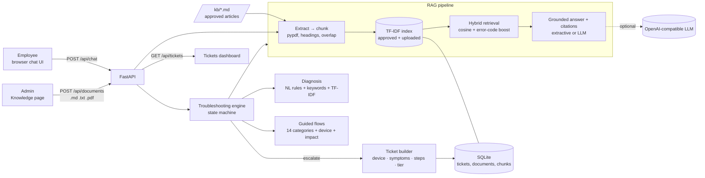
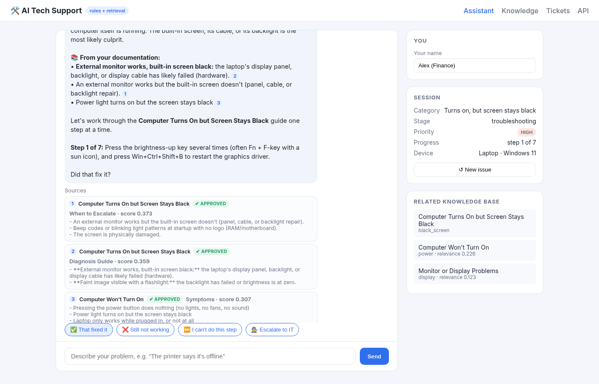
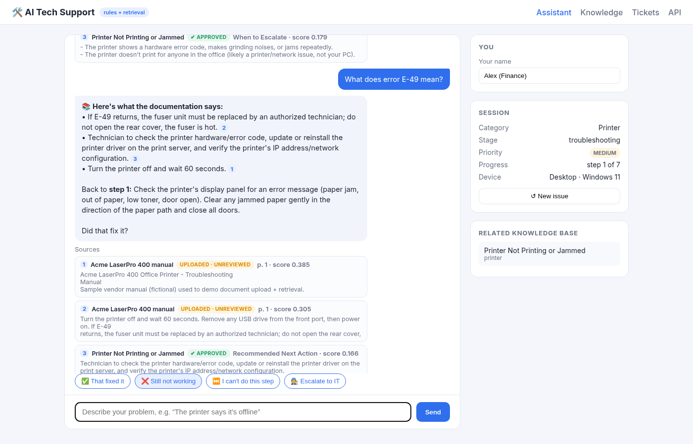
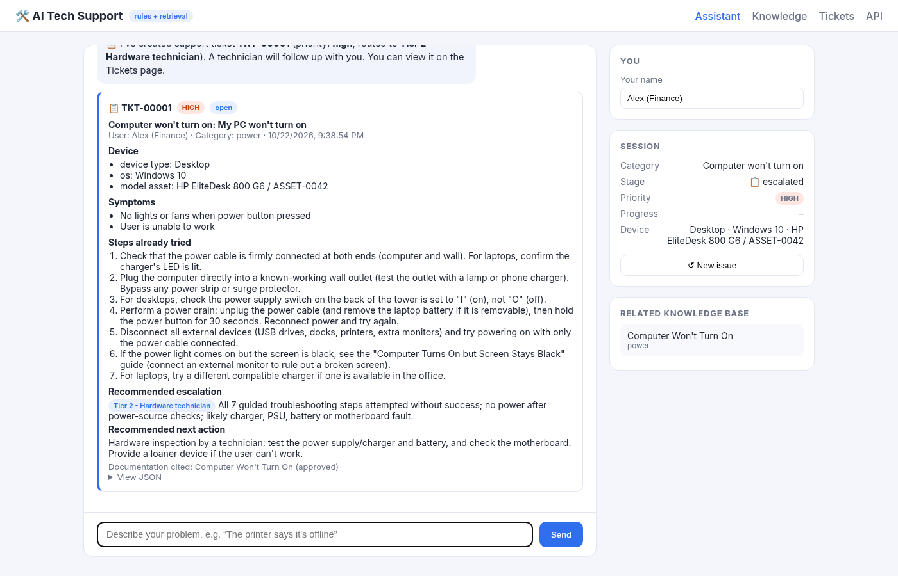
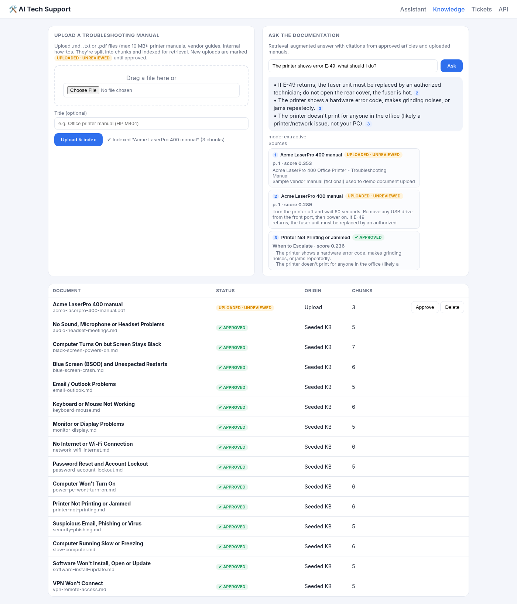
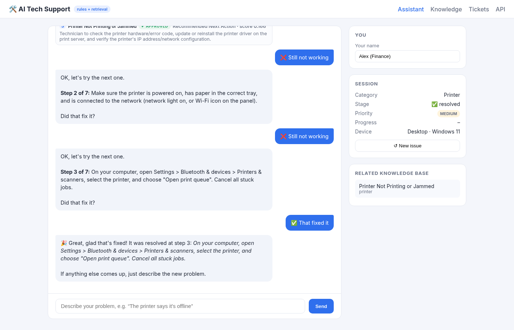
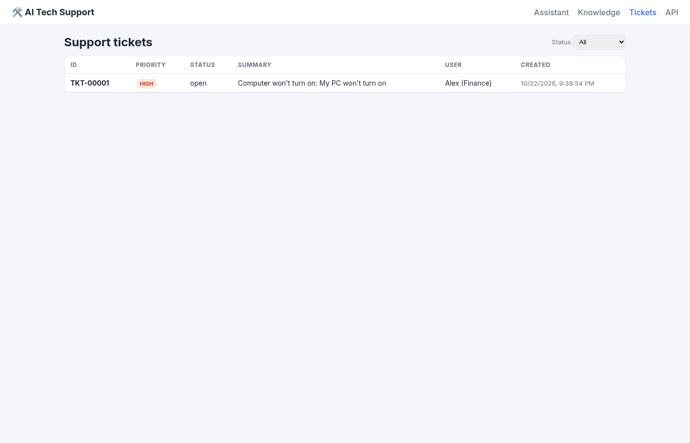

# 🛠️ AI Tech Support Assistant

**Retrieval-augmented IT troubleshooting for small companies without an IT department.**

An employee describes a problem in plain English ("my laptop turns on but the screen stays black").
The assistant works out what kind of problem it is, asks targeted follow-up questions, walks the user
through fixes **grounded in the company's own troubleshooting manuals (with citations)**, and if the issue
still isn't fixed, opens a **structured support ticket** with everything a technician needs.

Python · FastAPI · scikit-learn (TF-IDF) · SQLite · pypdf · vanilla HTML/JS · pytest · Playwright

---

## The problem

A 50-person company with no IT staff loses time on the same issues again and again: printers, Wi-Fi,
lockouts, dead laptops. When someone finally calls an outside technician, the report is usually just
"my computer's broken", with no symptoms, no device details and no record of what was already tried.

This project tackles both sides:

1. **Self-service:** guide employees through proven fixes, using approved articles and vendor manuals.
2. **Better escalation:** when self-service fails, hand off a complete, prioritized ticket routed to the right support tier.

## Key features

### 📚 Retrieval-Augmented Generation (RAG) over your own documentation
- **Two document tiers:** 14 seeded, **approved** knowledge-base articles, plus **uploaded** manuals (`.md`, `.txt`, `.pdf`). Uploads are marked *unreviewed* until someone approves them.
- **Ingestion pipeline:** text extraction (pypdf for PDFs, keeping page numbers) → heading-aware chunking with overlap → TF-IDF index (unigrams + bigrams) stored in SQLite and rebuilt automatically when documents change.
- **Hybrid retrieval:** cosine similarity plus an exact-match boost for error codes (`E-49`, `0x0000007E`), so a question like "printer shows E-49" finds the right page of a vendor PDF. Approved content outranks unreviewed uploads when scores are close.
- **Grounded answers with citations:** answers cite their sources inline (`[1]`, `[2]`), and the UI shows each source's title, section or page, relevance score and approval status.
- **Works with no API key:** without an LLM, answers are built by picking the retrieved sentences that best match the question. With `OPENAI_API_KEY` set, an LLM writes the answer **only from the retrieved chunks** (it is told to reply `NO_ANSWER` if the sources don't cover the question).
- **Ask anytime:** users can ask a free-form question in the middle of troubleshooting ("what does E-49 mean?") and get a cited answer without losing their place. There is also an "Ask the documentation" box and a `POST /api/ask` endpoint.

### 🔎 Diagnosis from plain English
- Pattern-based rules run first, then keyword + TF-IDF scoring. "Turns on, **but** the screen stays black" goes to a *black-screen* flow, not a *won't power on* flow.
- **Targeted questions per category (14 flows):** for example, *Does an external monitor work?*, *Which startup signs do you notice: lights, fan, chime, beep codes?*, *Do you see the manufacturer logo?*
- **Answers change the path:** they can switch flows (power → black screen), raise priority, trigger an immediate safety escalation ("burning smell" → unplug now, urgent ticket), add a 🔎 diagnosis explanation, or skip steps the user already did.
- **No repeat questions:** device type and OS mentioned in the description ("my Windows 11 laptop") are filled in automatically.

### 📋 Structured ticket generation
When the steps run out or the user asks for a human, the assistant asks for the **model / asset tag** and creates a ticket (JSON + readable view) containing:

| Field | Example |
|---|---|
| `id`, `status`, `priority` | `TKT-00001`, `open`, `high` (set by impact answers and risk flags) |
| `user`, `category`, `summary`, `description` | `Alex (Finance)`, `power`, … |
| `device` | `{device_type: Desktop, os: Windows 10, model_asset: HP EliteDesk 800 G6 / ASSET-0042}` |
| `symptoms` | `No lights or fans when power button pressed`, `User is unable to work` |
| `steps_tried` | every step attempted, skipped, or covered during diagnosis |
| `escalation` | `{level: "Tier 2 - Hardware technician", reason: "All 7 guided steps attempted without success; no power after power-source checks…"}` |
| `recommended_next_action` | from the matching KB article |
| `sources`, `kb_articles`, `transcript` | documents cited in the conversation, related articles, full chat log |

There is also a tickets dashboard (filter by status, update status, view the transcript, plain-text export).

### Other
- The LLM is optional: if `OPENAI_API_KEY` is set (any OpenAI-compatible endpoint, including local models), replies get friendlier wording. If the LLM fails, the app falls back to the deterministic reply.
- 46 pytest tests (unit + API end-to-end), plus a Playwright script that drives the real UI in headless Chromium and saves the screenshots below.
- Interactive API docs at `/docs` (FastAPI / OpenAPI).

## Architecture



**Conversation lifecycle:** `start → (clarify) → questions → steps ⇄ RAG Q&A → resolved | device_details → escalated`

```
app/
  main.py      FastAPI routes (chat, documents, ask, tickets, KB, pages)
  engine.py    conversation state machine, diagnosis, step-by-step guidance, escalation
  flows.py     categories, NL diagnosis rules, question flows, device questions, escalation tiers
  rag.py       document ingestion, chunking, TF-IDF index, hybrid retrieval, grounded answers
  kb.py        parses approved markdown articles (steps, escalation criteria, next action)
  db.py        SQLite ticket store + plain-text ticket rendering
  llm.py       optional LLM polish + grounded generation with safe fallback
  static/      chat UI, knowledge/upload page, tickets dashboard
kb/            14 approved troubleshooting articles (markdown)
docs/          screenshots + a sample vendor manual (PDF/MD) for the upload demo
tests/         pytest suite (KB, RAG, engine, API end-to-end)
scripts/       Playwright browser E2E + screenshot script
```

## Running it

```bash
python -m venv .venv && source .venv/bin/activate
pip install -r requirements.txt
uvicorn app.main:app --reload
# open http://127.0.0.1:8000
```

Try:
1. **Knowledge** page: upload `docs/sample-manuals/acme-laserpro-400-manual.pdf`, then ask *"The printer shows error E-49, what should I do?"*
2. **Assistant:** *"My laptop turns on, but the screen stays black"*: answer the targeted questions and watch the diagnosis and citations.
3. **Assistant:** *"My PC won't turn on"*: click "Still not working" through the steps, give an asset tag, and open the ticket on the **Tickets** page.

Optional LLM mode:
```bash
export OPENAI_API_KEY=sk-...            # or any OpenAI-compatible key
export OPENAI_BASE_URL=https://api.openai.com/v1  LLM_MODEL=gpt-4o-mini
```

### Tests
```bash
pip install -r requirements-dev.txt
pytest -q                                   # 46 tests
python -m playwright install chromium       # once
python scripts/e2e_screenshots.py           # with the server running; drives the UI, saves screenshots
```

## Screenshots

| | |
|---|---|
| **Diagnosis from plain English + grounded steps**<br> | **Cited answer from an uploaded PDF manual during troubleshooting**<br> |
| **Escalation → structured ticket**<br> | **Upload manuals and ask the documentation**<br> |
| **Printer issue resolved at step 3**<br> | **Tickets dashboard**<br> |

## Design decisions
- **Deterministic core, optional LLM.** The decision flow and retrieval decide *what* to say, so behavior is predictable and testable and costs nothing to run. The LLM only improves wording, or writes answers restricted to retrieved sources.
- **TF-IDF instead of neural embeddings** keeps the app small, offline and fast on a laptop, and handles exact technical terms (error codes, menu names) well. The retriever sits behind one class (`DocumentIndex.search`), so it can be swapped for embeddings later.
- **Approval status** matters for support content: unreviewed vendor PDFs can help, but they're labeled as unreviewed and rank slightly below approved articles.

## Limitations (MVP)
- No authentication or roles. Anyone can upload or approve documents and see tickets.
- Chat sessions are kept in memory (tickets and documents are stored in SQLite).
- PDF support covers text-based PDFs only (no OCR for scanned manuals).

## Future work
- Local sentence embeddings + hybrid BM25 re-ranking; retrieval evaluation set (recall@k)
- Auth with employee/technician/admin roles; email/Teams notifications on new tickets
- Learn from resolved tickets: surface steps that most often fix each category
- Integrations: Microsoft 365 admin (unlock accounts), device inventory lookup by asset tag
- Docker image + CI (GitHub Actions running pytest and the Playwright E2E)
